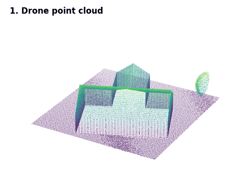
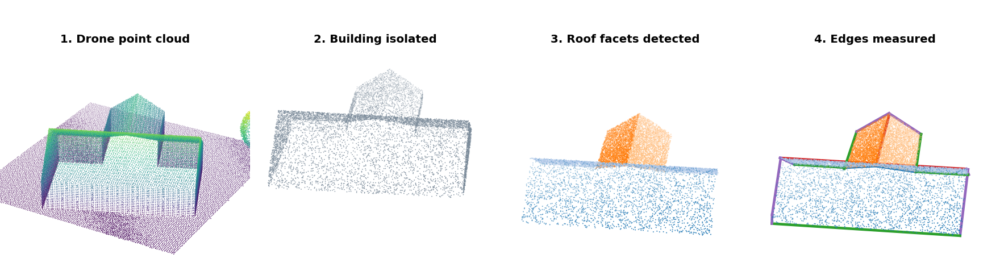
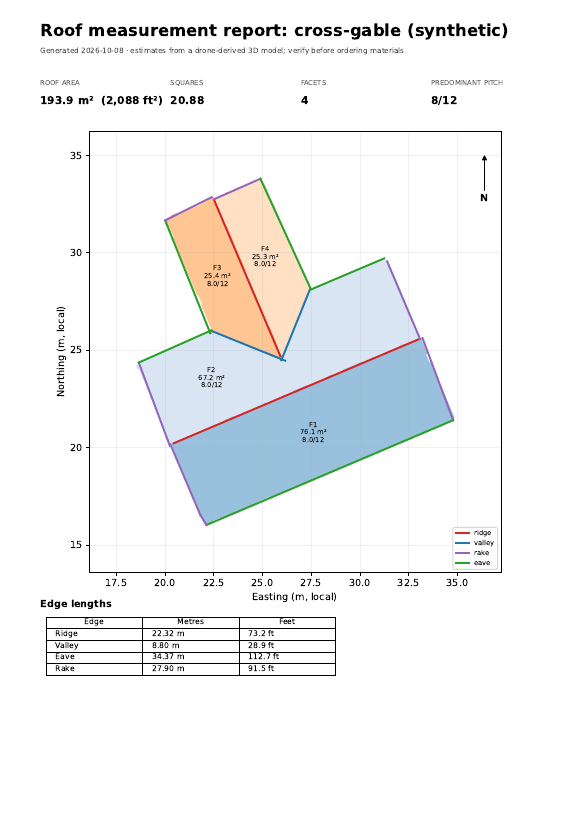
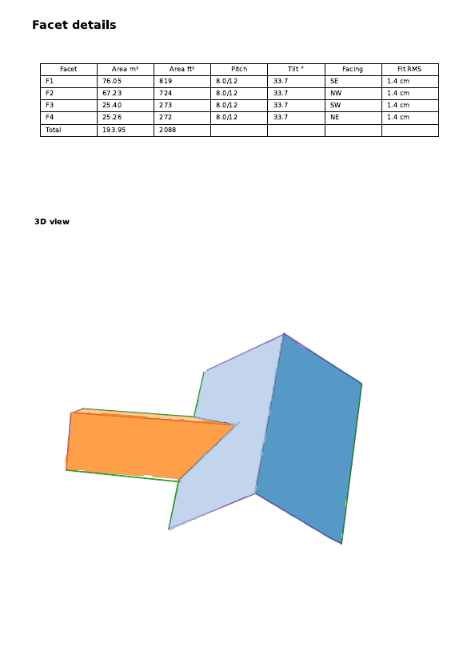
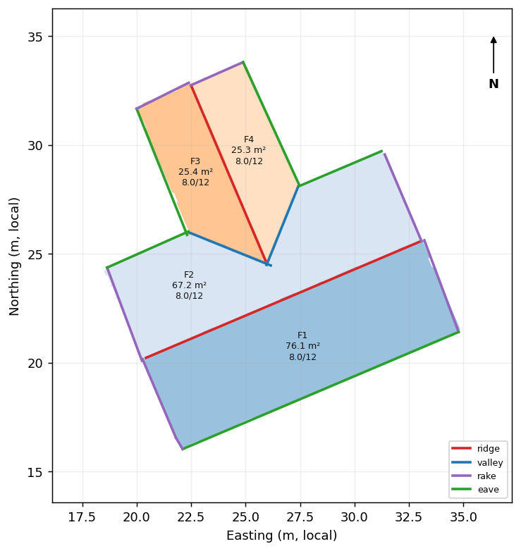
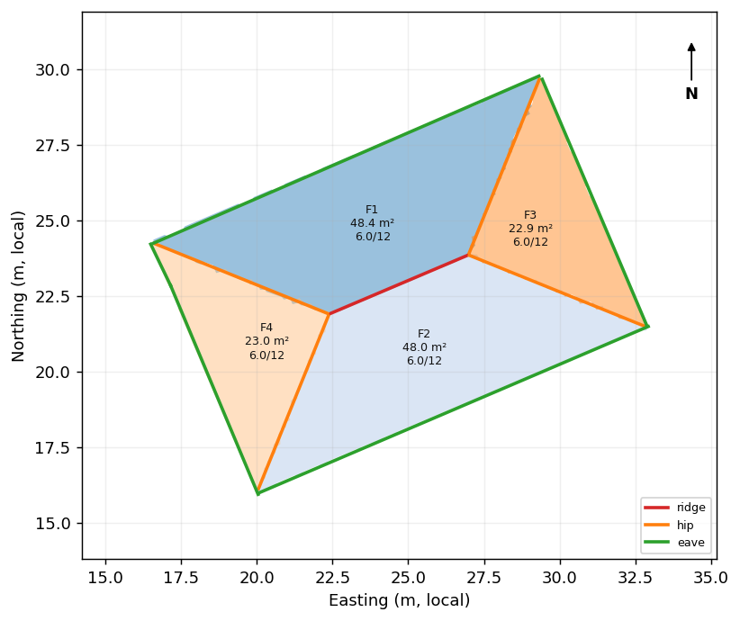
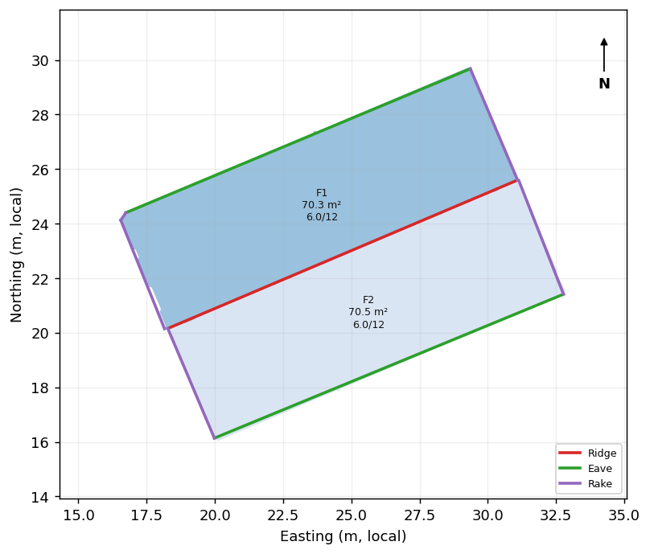
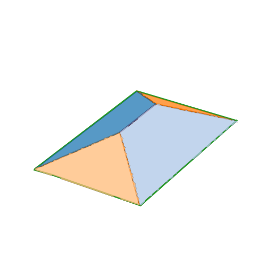

# Roof Measurements from Drone Images

**Drone photos in → roof measurement report out.** Facet areas, pitch, and ridge, hip, valley, eave and rake lengths, generated automatically from a 3D point cloud.

  

  

## Who this is for

- **Roofing contractors:** quote jobs from a 10-minute drone flight instead of climbing the roof with a tape measure.
- **Solar installers:** get the pitch, facing direction and usable area of every roof plane for panel layout.
- **Insurance and claims inspectors:** consistent, documented roof measurements for every claim.
- **Drone service companies:** add roof reports to your flights without building the processing in-house.

## What you get

Every report contains:

| | |
|---|---|
| **Totals** | Sloped roof area (m², ft², roofing squares), plan area, predominant pitch |
| **Per facet** | Area, pitch (x/12 and degrees), facing direction (N, SE, …), fit quality |
| **Edges** | Ridge, hip, valley, eave and rake lengths in metres and feet |
| **Files** | Two-page PDF report, JSON and CSV for your estimating software, colour-coded 3D point cloud |

### Sample report

  
  

Full reports:

| Roof | Report | Data |
|---|---|---|
| Cross-gable (with valleys) | [PDF](examples/cross-gable/roof_report.pdf) | [JSON](examples/cross-gable/roof.json) · [CSV](examples/cross-gable/facets.csv) |
| Hip | [PDF](examples/hip/roof_report.pdf) | [JSON](examples/hip/roof.json) · [CSV](examples/hip/facets.csv) |
| Gable | [PDF](examples/gable/roof_report.pdf) | [JSON](examples/gable/roof.json) · [CSV](examples/gable/facets.csv) |

### Plan diagrams

  
  
  

Edge colours: 🟥 ridge · 🟧 hip · 🟦 valley · 🟩 eave · 🟪 rake

## Accuracy

Tested on simulated drone scans of houses with exactly known dimensions. Each scene includes walls, sloped ground, a tree beside the house, sensor noise, and real-world (UTM) coordinates.

| Roof | Pitch | Area error | Ridge | Hip | Valley | Eave | Rake |
|---|---|---|---|---|---|---|---|
| Gable | 6/12 | **−0.0 %** | 13.78 / 14.00 | – | – | 27.5 / 28.0 | 20.0 / 20.1 |
| Hip | 6/12 | **+1.0 %** | 5.01 / 5.00 | 26.3 / 27.0 | – | 45.6 / 46.0 | – |
| Cross-gable | 8/12 | **+0.8 %** | 22.3 / 23.0 | – | 8.80 / 8.44 | 34.4 / 35.2 | 27.9 / 28.1 |
| Shed | 3/12 | **−1.0 %** | – | – | – | 13.8 / 14.0 | 18.3 / 18.6 |
| Hip, 3 cm noise | 9/12 | **+2.8 %** | 5.05 / 5.00 | 28.0 / 28.8 | – | 45.7 / 46.0 | – |

Lengths are measured / true, in metres.

- Facet count was correct on every roof.
- Pitch was within 0.2° on every facet.
- Each roof takes 2–3 seconds to process.

These results come from simulated scans. Validation on real flights is under way, and results will be added here.

## How it works

1. **3D reconstruction.** Drone photos with GPS become a georeferenced point cloud in real-world metres.
2. **Building isolation.** Ground, trees and neighbouring structures are separated from the target building.
3. **Roof plane detection.** Every roof face is found as a plane. Walls and clutter are rejected.
4. **True sloped measurement.** Each facet is measured in its own plane, so areas are the real surface that shingles cover, not the footprint.
5. **Edge classification.** Ridges, hips and valleys are computed from exact plane intersections. Outer edges become eaves and rakes.

 

### Inputs accepted

- **Drone photos** with GPS. A nadir grid plus one oblique orbit gives the best results. Any consumer drone, such as a DJI Mini or Mavic, is fine.
- **Existing point clouds** from Pix4D, Metashape, DroneDeploy, OpenDroneMap or LiDAR (`.las`, `.laz`, `.ply`, `.xyz`).

## About

Built by **Muhammad Ali**, a computer vision engineer with 7+ years of experience producing 3D models and ground truth from drone imagery for roofing, solar and telecom inspection platforms. MSc Electrical Engineering (AI & Autonomous Systems); Researcher in robotic perception.

I also build custom pipelines: photogrammetry and point-cloud processing, digital twins, and detection and segmentation models deployed to the cloud or edge devices.

## Get a free report

Send me drone photos, or a point cloud, of one roof and I'll send back a measurement report free of charge.

- **Email:** muhammad.ali.sid25@gmail.com
- **GitHub:** [@M-A-S1](https://github.com/M-A-S1)

---

The processing software is proprietary and is not included in this repository. © 2026 Muhammad Ali. All rights reserved.
